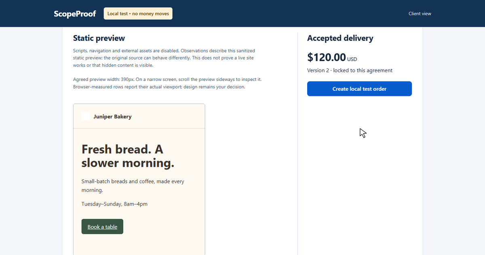
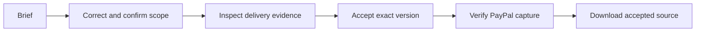

<div align="center">

<h1>ScopeProof</h1>

<p><strong>Agree on done. Pay for the version you accepted.</strong></p>

<p>A clearer handoff for static-site freelancers and their clients.</p>

<p>
  <a href="https://www.youtube.com/watch?v=DwSiwlDlGz8"><strong>▶ Watch the narrated demo · ~2:28</strong></a>
  &nbsp; · &nbsp;
  <a href="JUDGE_SETUP.md">Run it locally</a>
  &nbsp; · &nbsp;
  <a href="EVIDENCE.md">Explore the evidence</a>
</p>

</div>

[](https://www.youtube.com/watch?v=DwSiwlDlGz8)

<p align="center"><sub>Cover: LOCAL_TEST demonstration. No money moves in this view.</sub></p>

## A small brief can hide a lot of questions

> “Make the landing page mobile friendly and add a booking button.”

Which viewport? What should the button say? Where should it go? And when a newer draft arrives, which source version did the client buy?

ScopeProof makes those decisions explicit: a checklist both people correct, delivery observations they can inspect, and acceptance tied to one immutable source version.

## From brief to the right source bundle

1. **Make the agreement clear.** Gemini drafts requirements with exact brief quotations and questions for missing details. Both parties correct and confirm the same scope version. Manual drafting works too.
2. **Review the delivery.** Upload a static-site ZIP and compare each agreed requirement with observations from a restricted browser. A wrong required link blocks acceptance; design quality remains the client’s decision.
3. **Accept one exact version.** The client explicitly accepts a bundle. Scope, artifact hash and the stored price are pinned together.
4. **Complete checkout and receive that source.** With PayPal sandbox configured, the buyer approves and the server verifies the completed capture before unlocking delivery. A later v3 upload cannot replace accepted v2.



### Four observations, one human decision

| Check | What the restricted browser observes |
|---|---|
| **Text** | Looks for the agreed words in the rendered preview. |
| **Link** | Checks the destination of a rendered link against the agreement. |
| **Image** | Checks that the agreed image file loads in the preview. |
| **Overflow** | Checks for horizontal scrolling at the agreed screen width. |

These observations describe a **sanitized static preview**. A matching destination does not prove booking works, and overflow is not design approval. Unavailable browser measurements stay **review-required**, never a fabricated pass.

## Try the bakery project

You can run the complete manual-criteria journey with **no API keys, accounts or money**. Use **Node.js 24+** and a fresh checkout without private `.env` or inherited provider credentials. **On Linux, use a non-root user with Chromium sandboxing enabled.**

```sh
git clone https://github.com/Hermes-25/scopeproof.git
cd scopeproof
npm ci
npx playwright install chromium
npm run build
npm run local
```

Open **http://localhost:3000** and look for **Local test · no money moves**. The included bakery fixtures let you follow **wrong-link v1 → corrected v2 → local test completion → v3 without replacing v2**.

**[Full Windows/POSIX setup and walkthrough →](JUDGE_SETUP.md)** includes tests, browser dependencies, alternate ports, private-link recovery and separate provider setup. Live Gemini requires your own eligible provider key; PayPal sandbox requires your own test accounts/app. Neither is needed for the manual local route.

## What Gemini and PayPal do

| Component | Its job |
|---|---|
| **Native Gemini API** | Draft quoted requirements and unanswered questions. The server validates grounding; people correct the result and confirm the scope. |
| **PayPal Orders v2** | Create the acceptance-bound sandbox order, support buyer approval and verify the seller, amount, order and completed capture. Unknown outcomes stay locked for reconciliation. |
| **React + TypeScript + Node.js + SQLite** | Present the four-stage journey and persist separate scope, artifact, acceptance, payment-attempt and exact-source entitlement records. |

AI does not accept work, decide payment or silently change a confirmed agreement.

## Watch it, then inspect the proof

The **[public narrated walkthrough](https://www.youtube.com/watch?v=DwSiwlDlGz8)** shows saved live Gemini output, a separate explicitly labeled **LOCAL_TEST** journey and a **previously completed PayPal sandbox receipt** shown read-only. It does **not** record fresh AI generation or a new PayPal approval/capture.

The reviewed application build passed; its full suite passed **129/129 on rerun**, and the overlapping browser-unavailable suite passed **112/112**. Historical validation completed one **USD 1.00 sandbox capture** and downloaded accepted v2 with v3 already present. See [evidence and limits](EVIDENCE.md).

<details>
<summary><strong>Test history, practical limits and export provenance</strong></summary>

### Test and AI evidence

- The initial full run was **128/129**: the first browser asset check returned review-required. Its cause remains unconfirmed. A focused rerun and the full rerun passed with no source, timeout or expectation changes. [BUILD_VERIFICATION.json](BUILD_VERIFICATION.json) preserves the initial failure. **129 and 112 overlap; do not add them.**
- Fresh extraction/install checks ran on the same Windows host with reused Chromium, not another physical computer or a new Linux/macOS install. The earlier separate-Linux-VM AI review was PARTIAL with browser-install/version limits.
- The literal-grounding incident’s **45 controlled compiler checks used mocked responses**. A saved live seven-row draft preserved exact quotation/value grounding and left scope unchanged; one success is not a reliability estimate. The small live baseline also retained semantic cases needing review. [Read the evidence](EVIDENCE.md).
- Human usefulness, demand and time saving remain unmeasured. Change-request triage was **discarded**, not shipped, after misleading evidence support in a synthetic diagnostic. The differentiator is this workflow, not a first-ever claim or new verification algorithm.

### Product and access boundaries

- This is a **local, single-merchant hackathon prototype**, supporting root-index HTML/CSS/raster ZIPs. Preview removes scripts and external resources; it is not proof of original-site behavior.
- Private seller/client links grant their holder that role, not verified identity. Keep the full seller link and storage private; one server process owns a data directory. New-judge live provider access has not yet been exercised; the setup guide explains own-account configuration and the private owner-assisted alternative.
- This is **not escrow or chargeback prevention**. Copies and source downloads cannot be revoked. No real incoming webhook is demonstrated. Pending/UNKNOWN financial results stay locked; cancellation or 404 alone is not proof of non-payment. Narrow abandoned-checkout recovery requires trusted server-only evidence, not a client assertion.

### About the 68-file manifest

[EXPORT_MANIFEST.json](EXPORT_MANIFEST.json) describes the **original reviewed 68-file source export** and excludes itself from its 67 hash rows. This README revision and `docs/images/scopeproof-cover.png` are **publication-only documentation changes**; that historical manifest is not a checksum list for the updated README or new cover. Application code and the earlier reviewed archives are unchanged. [Export notes](EXPORT_NOTES.md) retain the snapshot’s provenance.

</details>

---

Built for the PayPal AI Hackathon. Source: **[Hermes-25/scopeproof](https://github.com/Hermes-25/scopeproof)** · **[MIT license](LICENSE)** · [Dependency notices](DEPENDENCY_NOTICES.json)
